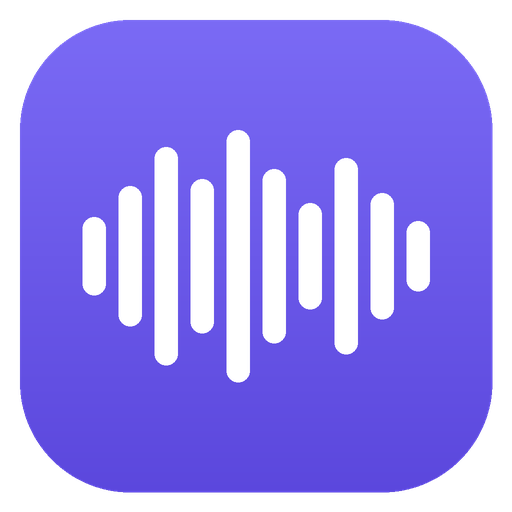
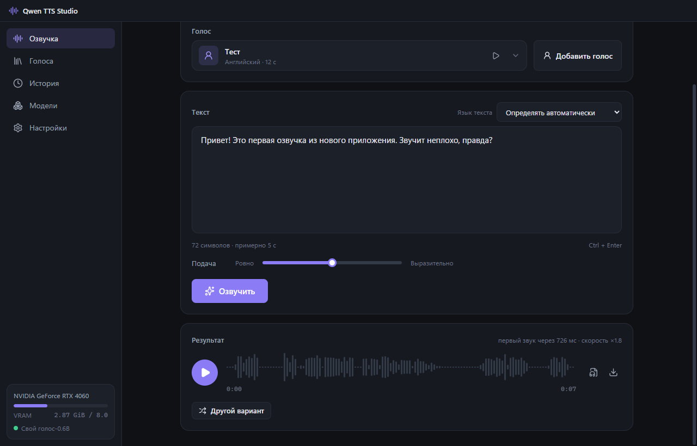
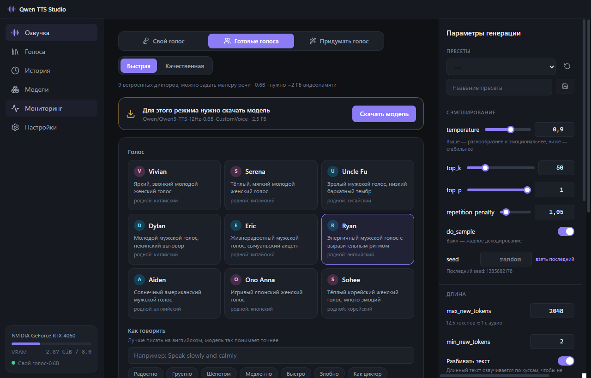
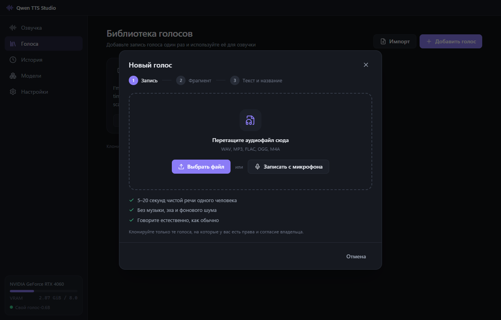
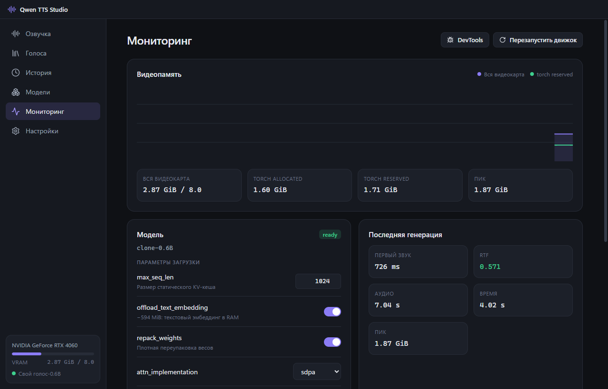
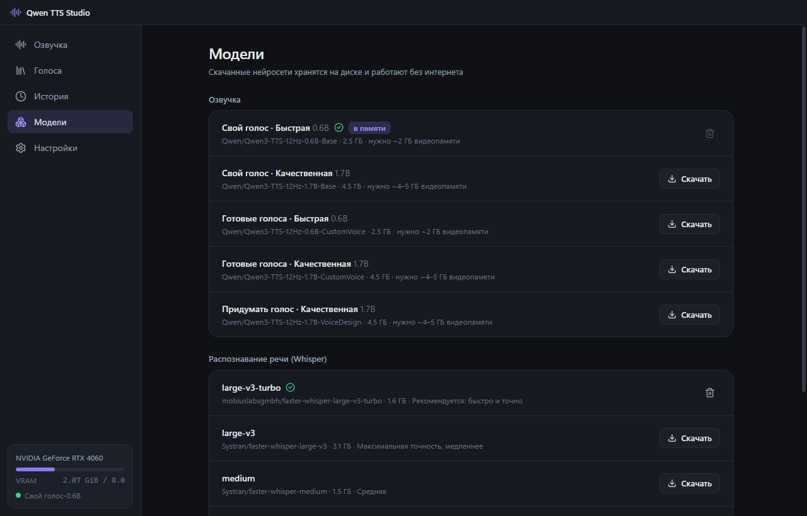
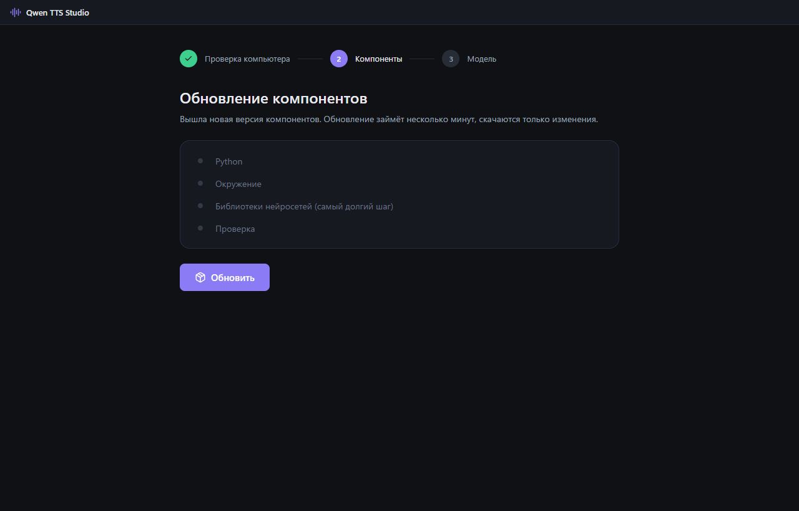

<div align="center">



# Qwen TTS Studio

**Desktop text-to-speech with [Qwen3-TTS](https://github.com/QwenLM/Qwen3-TTS) on an ordinary graphics card.**
A Windows app with a simple UI and a real installer, using about half the usual VRAM thanks to [qwen3-tts-lowvram](https://github.com/Oatis123/qwen3-tts-lowvram).

[**Download for Windows**](https://github.com/Oatis123/qwen3-tts-lowvram-ui/releases/latest)



</div>

> The app's interface is currently in Russian.

## Features

- **Your voice.** Clone a voice from a 5–20 s recording, from a file or your microphone. The app picks a clean fragment and transcribes it automatically with Whisper.
- **Voice library.** Add a voice once and pick it from a list afterwards. Voices can be exported to a file and shared.
- **Built-in voices.** 9 Qwen3-TTS speakers. Describe the delivery in words: "happily", "whisper", "like a news anchor".
- **Voice design.** Create a voice from a text description ("a deep, raspy male voice, speaks slowly"). Save the ones you like to the library.
- **Pick a model:** 0.6B (fast, ~2 GB of VRAM is enough) or 1.7B (better quality). Download only the ones you need, and load or unload them from VRAM with a button. The sidebar shows what's in memory and what's downloading.
- **Streaming playback.** Audio starts in about 0.4 s. Long texts are split and voiced in parts, with no length limit.
- **Export to WAV and MP3**, plus a history of every generation that can be replayed with the same settings.
- **Developer mode:** every generation and lowvram parameter, presets, a live VRAM chart, engine logs and a local HTTP API.
- **Offline.** After the first setup everything runs locally, with no internet needed.

<table>
  <tr>
    <td></td>
    <td></td>
  </tr>
  <tr>
    <td></td>
    <td></td>
  </tr>
</table>

## Requirements

- Windows 10 or 11, 64-bit
- An NVIDIA GPU (GTX 10xx or newer) with a recent driver: at least 2 GB of VRAM for the 0.6B model, 5 GB for 1.7B
- About 10 GB of disk space: ~6 GB of components, plus 2.5–4.5 GB per model
- An internet connection for the first run

## Installation

1. Download `QwenTTSStudio-Setup-*.exe` from the [releases page](https://github.com/Oatis123/qwen3-tts-lowvram-ui/releases/latest).
2. Run it and choose an install folder, ideally on a drive with plenty of free space.
   Windows may warn about an "unknown publisher" because the installer isn't code-signed. Click "More info" → "Run anyway".
3. On first launch a setup wizard checks your GPU and downloads the components (~3 GB) and the Whisper speech recognition model (1.6 GB). Text-to-speech models are downloaded later, from the Models page or right on the main screen.

The app updates itself. Updates don't re-download components or models.



## Where data is stored

Everything the app downloads or creates stays in the install folder, under `UserData`:

```
<install folder>\
  Qwen TTS Studio.exe, resources\…    the app
  UserData\
    runtime\       Python and the ML libraries
    cache\         uv, HuggingFace and CUDA caches, downloaded updates
    data\          models\, voices\, history\
    electron\      window data
    settings.json
```

- Nothing is written to system locations (AppData, `~/.cache`, the Python registry keys). Install to D: and everything lives on D:.
- Updates leave `UserData` alone. When you uninstall, the app asks whether to delete the downloaded models and voices.
- If the install folder isn't writable (for example, Program Files), data goes to `%LOCALAPPDATA%\Qwen TTS Studio` and the setup wizard tells you so.

## How it works

```
Electron (main)  ── IPC ──  React UI (renderer)
   │  uv: Python 3.12 + torch (CUDA 12.8) → UserData\runtime
   │  model downloads from HuggingFace → UserData\data\models
   └─ spawn ─> backend/main.py (FastAPI on 127.0.0.1:<random port>, token auth)
                 ├─ qts/engine.py   FasterQwen3TTS + optimize() from qwen3-tts-lowvram
                 ├─ qts/asr.py      faster-whisper on the GPU, unloaded after each transcription
                 ├─ qts/store.py    voice library and history
                 └─ qts/compat.py   local API (/play, /synthesize, /synthesize_stream…)
```

The installer is about 115 MB. Python, torch and Whisper are downloaded on first run, and text-to-speech models when you choose them. Python dependencies are pinned in `backend/requirements.lock`. When a new app version changes it, the wizard offers to update the components and only the differences are downloaded.

### Local API

Turn it on in Settings → Local API (developer mode required). The endpoints match `examples/server.py` from qwen3-tts-lowvram, and the voice used by the API is chosen in the same settings section.

```bash
curl -X POST localhost:2027/synthesize -H "Content-Type: application/json" -d '{"text":"Hello!"}' -o out.wav
```

| Endpoint | |
|---|---|
| `GET /ping` | health check |
| `POST /play` `{"text"}` | queue a line for playback |
| `POST /stop` | clear the queue and stop playback |
| `GET /is_playing` | `{"is_playing": bool}` |
| `POST /synthesize` `{"text"}` | WAV, 24 kHz mono |
| `POST /synthesize_stream` `{"text"}` | raw s16le PCM, 24 kHz, as it's generated |

## Development

```bash
npm install
npm run fetch-uv
npm run dev
```

Set `QTS_HOME` to keep all app data (runtime, models, settings) in a folder of your choice, which is handy for testing.

To rebuild the lock file after editing `backend/requirements.in`:

```bash
resources/bin/uv.exe pip compile backend/requirements.in -o backend/requirements.lock --python-version 3.12 --python-platform x86_64-pc-windows-msvc --index-url https://pypi.org/simple --extra-index-url https://download.pytorch.org/whl/cu128 --index-strategy unsafe-best-match --no-header
```

`transformers` is pinned to 5.16.1: from 5.17 on, qwen-tts fails to load the codec (`MimiConfig has no attribute rope_theta`).

### Building and releasing

```bash
npm run dist
```

This produces `dist/QwenTTSStudio-Setup-<version>.exe`. For a release, bump `version` in `package.json` and upload three files to a GitHub release: the `.exe`, the `.exe.blockmap` and `latest.yml`. Auto-update relies on them. `npm run release` with `GH_TOKEN` set does it in one step.

## License

Apache-2.0. This is an independent project, not affiliated with or endorsed by the Qwen team / Alibaba or the authors of faster-qwen3-tts and faster-whisper. Models and libraries are downloaded separately under their own licenses.

**Voice cloning:** only clone voices you have the right to use, with the speaker's consent. Don't use generated speech to impersonate or deceive.
